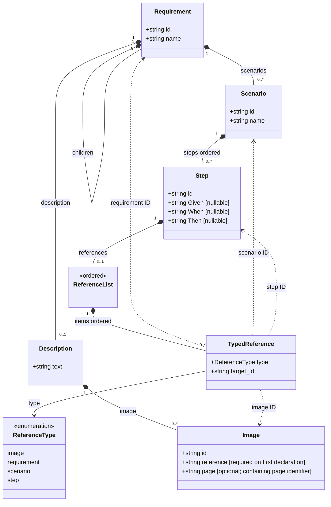

# Requirement Metamodel

This metamodel represents system behavior as a requirement tree and connects text, images, scenarios, and steps through referenceable IDs. Requirement nodes organize and describe behavior. Scenarios group behavioral examples, and each step states a condition, an action, and an expected result using Given, When, and Then. Images belong to descriptions; their optional `page` identifies the page containing the depicted content, without requiring a separate page node.

The compiler normalizes descriptions, images, scenario steps, and typed references from this format. Explicit image page identifiers are preserved in the frontend design context and used to locate the corresponding UI tree.

## Files and Fields

A YAML document contains one root requirement. Its `children` recursively contain further requirement nodes. See [example/requirements.yaml](example/requirements.yaml) and the accompanying images in [example/reference/](example/reference/).

| Object | Field | Meaning |
| --- | --- | --- |
| Requirement | `id` | Requirement ID, referenceable from steps |
| | `name` | Requirement name |
| | `description` | Description containing text and images |
| | `scenarios` | List of scenarios |
| | `children` | List of child requirement nodes |
| Scenario | `id` | Scenario ID |
| | `name` | Scenario name |
| | `steps` | Ordered list of steps |
| Step | `id` | Step ID |
| | `Given` | Preconditions; may be empty |
| | `When` | Action; may be empty |
| | `Then` | Expected result; may be empty |
| | `references` | Optional list of typed references |
| Description | `text` | Descriptive text |
| | `image` | List of images, each with an `id` and a `reference` on its first declaration |
| Image | `id` | Image ID, retained when the same image is used again |
| | `reference` | Relative image file path; may be omitted when the image reuse rules apply |
| | `page` | Optional stable page identifier for a whole-page image, state, or component shown on that page |

In the normalized representation, requirements and scenarios have nonempty `id` and `name` fields, and steps have a nonempty `id`. A requirement may omit `description`, `scenarios`, and `children`; a scenario may omit `steps`. Omitted collections are treated as empty lists. A description may omit `text` and `image`, which are treated as an empty string and an empty list, respectively.

The three behavioral fields of a step may be omitted or set to `""` or `null`. An empty field means that this step does not separately state that part of the behavior. It does not automatically copy content from a previous step or a referenced object. List order determines step order within a scenario.

## Descriptions and Images

`description` is an object containing `text` and `image`:

```yaml
description:
  text: Display the notes list with a Delete button on each card.
  image:
    - id: IMG-NOTES
      reference: reference/notes.svg
      page: notes
```


An image's `reference` is a single file path. A step's `references` is a list of typed references. These fields have different meanings:

```yaml
# First declaration: provide the image ID and file path.
description:
  text: The notes list.
  image:
    - id: IMG-NOTES
      reference: reference/notes.svg
      page: notes

# A later requirement can reuse the image by ID alone.
# description:
#   text: The deletion entry point on the same list.
#   image:
#     - id: IMG-NOTES
```

Image reuse follows these rules:

1. The first occurrence of an image ID must include a nonempty `reference`.
2. A later occurrence of the same ID may omit `reference` when it refers to exactly the same path. Explicitly repeating that same path is also allowed.
3. An existing image ID cannot point to a different image. Use a different ID for another image or visual state.
4. Earlier occurrences are determined by preorder traversal: read the current requirement's description, then its scenarios and steps, and finally its children in list order.
5. Paths are relative to the YAML file and use `/` as the separator. Explicit paths for the same ID must be identical strings; path aliases cannot silently change a declaration.
6. An image may declare a nonempty `page`. Later occurrences inherit it when omitted; any explicit repetition must match. A page may be supplied on a later occurrence if it has not previously been declared for that image.

`page` is a document-wide, case-sensitive grouping identifier, not a URL, an image ID, or a required UI component name. Equal values mean one page and one page UI tree; different explicit values identify different pages. An image may show the entire page, an alternate page state, or a component belonging to it. For example, both images below belong to the notes page, so the dialog is added to its existing tree:

```yaml
description:
  image:
    - id: IMG-NOTES
      reference: reference/notes.svg
      page: notes
    - id: IMG-DELETE-CONFIRMATION
      reference: reference/delete-confirmation.svg
      page: notes
```

Different images or states retain distinct image IDs. Reusing an image by ID inherits both its path and page, including from a typed image reference in a step. When no occurrence declares `page`, the frontend designer infers page ownership from the requirement, image analysis, and existing UI tree. No additional page declaration or reference type is introduced.

## Typed References

The reference syntax is `\ref[type](ID)`. The type in square brackets must be one of the four values below. The ID in parentheses must identify an object of that type in the document.

| Type | Example | Target |
| --- | --- | --- |
| `image` | `\ref[image](IMG-NOTES)` | Image declaration |
| `requirement` | `\ref[requirement](REQ-DELETE)` | Requirement node |
| `scenario` | `\ref[scenario](SCN-DELETE)` | Scenario |
| `step` | `\ref[step](STEP-DELETE-OPEN)` | Step |

Requirement, scenario, and step IDs are unique within their respective types. Image IDs may be reused according to the rules above. The type is part of a reference's identity. The example uses `REQ-`, `SCN-`, `STEP-`, and `IMG-` prefixes for readability; these prefixes are not required syntax. Every target must be declared in the current document. Only the image shorthand that omits the file path requires an earlier declaration.

Use YAML single quotes to preserve the backslash, for example `'\ref[image](IMG-NOTES)'`. Literal block scalars such as `text: |-` also preserve backslashes. Do not place an unescaped `\ref` inside a YAML double-quoted string: its `\r` can be interpreted as a carriage return.

## BNF

The abstract BNF below describes field structure rather than redefining the full YAML grammar. `{}` denotes a mapping, `[]` denotes a sequence, `<string>` denotes a decoded string, and `ε` denotes an empty production. Mapping field order is not significant. The example uses equivalent YAML indentation.

```bnf
<document> ::= <requirement>

<requirement> ::= "{" "id:" <id> "," "name:" <string>
                  <description-field> <scenarios-field> <children-field> "}"
<description-field> ::= ε | "," "description:" <description>
<scenarios-field> ::= ε | "," "scenarios:" <scenario-list>
<children-field> ::= ε | "," "children:" <requirement-list>

<requirement-list> ::= "[" "]" | "[" <requirements> "]"
<requirements> ::= <requirement> | <requirement> "," <requirements>

<description> ::= "{" <content-fields> "}"
<content-fields> ::= ε | "text:" <string> | "image:" <image-list>
                   | "text:" <string> "," "image:" <image-list>
<image-list> ::= "[" "]" | "[" <images> "]"
<images> ::= <image> | <image> "," <images>
<image> ::= "{" "id:" <id> <image-reference-field> <image-page-field> "}"
<image-reference-field> ::= ε | "," "reference:" <relative-path>
<image-page-field> ::= ε | "," "page:" <page-id>

<scenario-list> ::= "[" "]" | "[" <scenarios> "]"
<scenarios> ::= <scenario> | <scenario> "," <scenarios>
<scenario> ::= "{" "id:" <id> "," "name:" <string> <steps-field> "}"
<steps-field> ::= ε | "," "steps:" <step-list>
<step-list> ::= "[" "]" | "[" <steps> "]"
<steps> ::= <step> | <step> "," <steps>
<step> ::= "{" "id:" <id> <given-field> <when-field> <then-field>
           <step-reference-field> "}"
<given-field> ::= ε | "," "Given:" <nullable-text>
<when-field> ::= ε | "," "When:" <nullable-text>
<then-field> ::= ε | "," "Then:" <nullable-text>
<nullable-text> ::= <string> | "null"
<step-reference-field> ::= ε | "," "references:" <reference-list>

<reference-list> ::= "[" "]" | "[" <references> "]"
<references> ::= <reference> | <reference> "," <references>
<reference> ::= "\ref[" <reference-type> "](" <id> ")"
<reference-type> ::= "image" | "requirement" | "scenario" | "step"
<id> ::= <nonempty-string>
<relative-path> ::= <nonempty-string>
<page-id> ::= <nonempty-string>
```

The BNF describes structure. ID uniqueness, reference type matching, first image declarations, and consistent paths and page identifiers for reused images are semantic rules beyond this grammar.

## Metamodel Diagram

Solid diamonds denote composition. Dashed arrows denote references resolved by type and ID. Descriptions contain text and images; typed reference lists belong to steps.



`TypedReference` is the conceptual representation of a parsed reference string. YAML uses `\ref[type](ID)` directly and does not require a separate object with `type` and `target_id` fields. An image can appear in multiple descriptions, but the same ID always resolves to the same image declaration.
